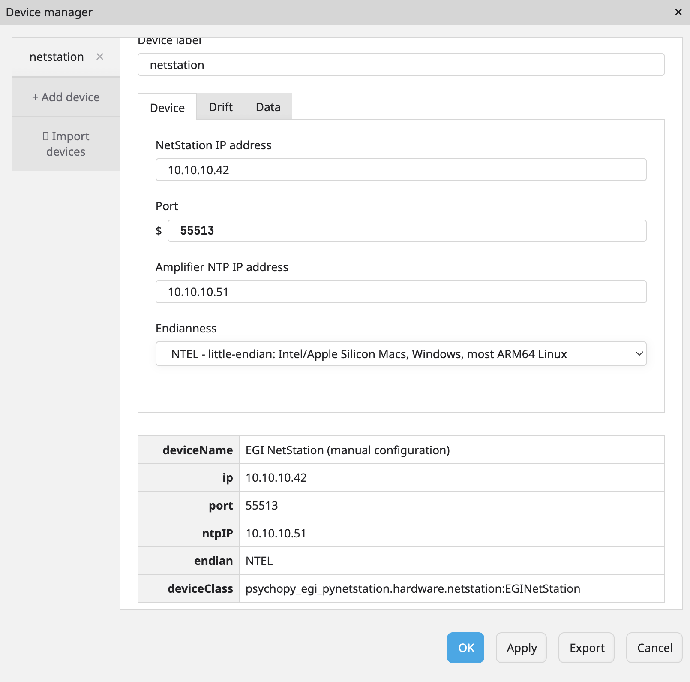
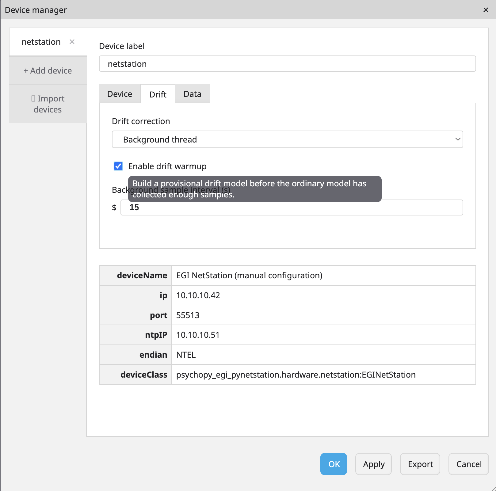

Builder and Studio Component reference
======================================

The plugin exposes three Components under **I/O > EEG** in PsychoPy Studio and
the classic desktop Builder in supported PsychoPy 2026.1+ releases: EGI Start
Recording, EGI Send Event, and EGI Stop Recording. Both interfaces provide
Device Manager. The former EGI Connect and EGI Disconnect classes remain
loadable for older ``.psyexp`` files, but are hidden from the Component panel.
New experiments should use Device Manager for connection setup and automatic
shutdown. PsychoPy versions before 2026.1 are not supported by this plugin.

Configure the device
--------------------

Open **Device Manager**, choose **Add Device > EGI NetStation**, and select the
manual-configuration profile. NetStation does not provide hardware discovery,
so this profile is an editable set of defaults rather than a detected device.
Give it a label such as ``netstation``. That label appears in the **Device**
selector on all three Components.

   Replace the example addresses with the NetStation host and amplifier NTP
   addresses used by your lab.

Profiles are stored in PsychoPy's per-user ``devices.json``, not in the
``.psyexp`` file. A ``.psyexp`` stores only the selected label. If the project
moves to another computer or user account, install the plugin and recreate or
import a profile with the same label before generating the script. Once
generated, the Python script contains the resolved device setup code.

.. list-table:: EGI NetStation Device Manager options
   :header-rows: 1
   :widths: 31 18 51

   * - Option
     - Default
     - Meaning
   * - **Device label**
     - user supplied
     - The name selected by EGI Components, for example ``netstation``.
   * - **NetStation IP address**
     - ``10.10.10.42``
     - Address of the computer running NetStation's ECI server.
   * - **Port**
     - ``55513``
     - TCP port on which the ECI server listens.
   * - **Amplifier NTP IP address**
     - ``10.10.10.51``
     - Address of the amplifier's NTP server. Blank uses the NetStation host.
   * - **Endianness**
     - ``NTEL``
     - Use ``NTEL`` for current Intel/Apple Silicon Macs, Windows, and most
       ARM64 Linux. ``MAC-`` is for legacy PowerPC Macs; ``UNIX`` is for legacy
       big-endian Unix and is not appropriate for most modern Linux systems.
   * - **Drift correction**
     - ``Background thread``
     - Samples clock drift automatically. ``Off`` disables correction and
       sampling.
   * - **Enable drift warmup**
     - off
     - Builds a provisional early-session drift model. Disabled when drift
       correction is off.
   * - **Background sample interval (s)**
     - ``15.0``
     - Target interval between background NTP samples.
   * - **Debug ECI traffic**
     - off
     - Prints every ECI command and response byte for diagnostics.
   * - **ECI error log file**
     - blank
     - Optional JSON-lines diagnostics path. Despite the historical label,
       this records drift-model status and session settings as well as errors.
   * - **Strict ECI responses**
     - off
     - Raises when a blocking ECI command receives a rejected or malformed
       response. Asynchronous send failures are reported during cleanup.

The generated setup code creates the device and calls ``connect()``. At
experiment shutdown, PsychoPy's Device Manager calls the wrapper's idempotent
``close()`` method. Cleanup stops active recording, flushes queued events,
reports session health, and disconnects. The wrapper also has a best-effort
destructor fallback.

The **Drift** tab enables automatic background sampling by default. The
optional warmup checkbox builds a provisional early-session model while the
ordinary model is still collecting evidence:

When **ECI error log file** is set to a writable ``.jsonl`` path, drift
logging is automatic; users do not need to add a Code Component or make a
per-trial logging call. The file includes the effective settings at session
start, model engagement and promotion, periodic ``drift_model_status``
records, and failures. A Code Component can add a snapshot at a meaningful
non-time-critical point with::

   deviceManager.getDevice("netstation").logRecord({
       "record": "drift_model_snapshot",
       **deviceManager.getDevice("netstation").driftEstimate(),
   })

Replace ``"netstation"`` with the configured Device label. Store the result
of ``getDevice()`` first if snapshots are taken more than once. Do not put
this call in a flip callback.

Options shared by all three Components
--------------------------------------

All three Components are one-shot commands. They run once at their Builder
**Start** condition and do not use the ordinary **Stop** condition.

.. list-table:: Common options
   :header-rows: 1
   :widths: 25 18 57

   * - Option
     - Default
     - Meaning
   * - **Name**
     - Component-specific
     - A valid, unique Python identifier.
   * - **Start**
     - ``time (s)``, ``0.0``
     - Determines when the one-shot command fires.
   * - **Stop**
     - blank
     - Ignored. EGI Send Event has a separate event-duration field.
   * - **Device**
     - blank
     - Select an EGI NetStation device configured in Device Manager.
   * - **Save onset/offset times**
     - on
     - Saves PsychoPy Component timing, not a NetStation acknowledgement time.
   * - **Disable Component**
     - off
     - Omits the Component action from generated code.

EGI Start Recording
-------------------

Starts EEG recording when its **Start** condition is met. Starting recording
also establishes the ECI event-timestamp epoch. One connection supports one
recording epoch; use a separate experiment run for another epoch.

The **Drift** tab can optionally wait until the drift model reports readiness.
Leave **Wait until drift correction is ready** off for the normal fast path.
Enable it for a planned pre-run pause and set the timeout and poll interval.
Because the call can block for minutes, do not schedule it near a visual flip.

The **Display** tab contains two session-level diagnostics:

* **Measure display refresh at startup** measures the actual refresh once,
  logs it, and records it in the optional ECI diagnostic log. It runs during
  setup, never during trials.
* **Warn about vulnerable schedules** compares fixed Routine durations with
  the measured frame period. Variable and response-terminated Routines are
  skipped because their durations are not known at build time.

EGI Send Event
--------------

Sends one event marker when its **Start** condition is met. Add one Component
for each marker point, or use Builder variables in its fields.

.. list-table:: EGI Send Event options
   :header-rows: 1
   :widths: 29 17 54

   * - Option
     - Default
     - Meaning
   * - **Target visual Component**
     - blank
     - Optionally enter the exact **Name** of a visual Component in the same
       Routine. Put EGI Send Event below that target. A target-bound marker is
       queued on the target's first drawing flip. Invalid, disabled, or unsafe
       targets stop code generation with an explanatory error.
   * - **Event type**
     - ``stim``
     - The main NetStation identifier; exactly four characters.
   * - **Event label**
     - blank
     - Human-readable label up to 256 characters. Blank uses Event type.
   * - **Event description**
     - blank
     - Optional description up to 256 characters.
   * - **Event duration (s)**
     - ``0.1``
     - Duration stored with the event; minimum ``0.001`` seconds.
   * - **Event data**
     - blank
     - Python dictionary such as ``{'trl_': trialN, 'corr': True}``. Keys must
       have exactly four characters.
   * - **Sync to screen refresh**
     - on
     - Uses ``win.callOnFlip`` so the timestamp is captured on the presenting
       flip. Target-bound markers are always flip synchronized.

The target field is deliberately plain text. PsychoPy Studio serializes
Component templates without a live Routine instance, so an instance-bound
method cannot safely populate a dropdown. Code generation still resolves and
validates the named target against the actual Routine.

Event sending is asynchronous: the timestamp is captured immediately and
network transmission does not block the display flip. See :doc:`timing` for
details and the equivalent Code Component pattern.

EGI Stop Recording
------------------

Stops EEG recording when its **Start** condition is met. Queued asynchronous
events are flushed first so a marker sent just beforehand is retained. Keep
this Component to define the precise recording endpoint; Device Manager still
closes the connection automatically when the experiment exits.
