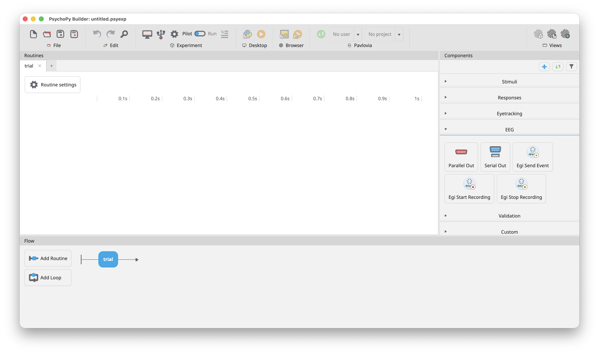
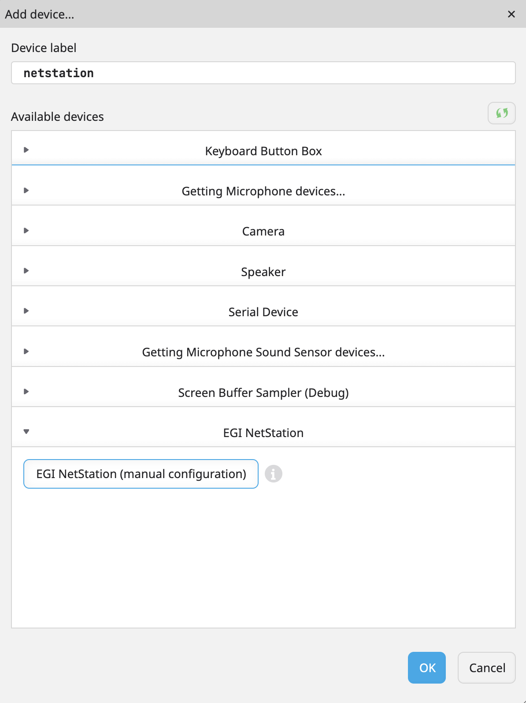
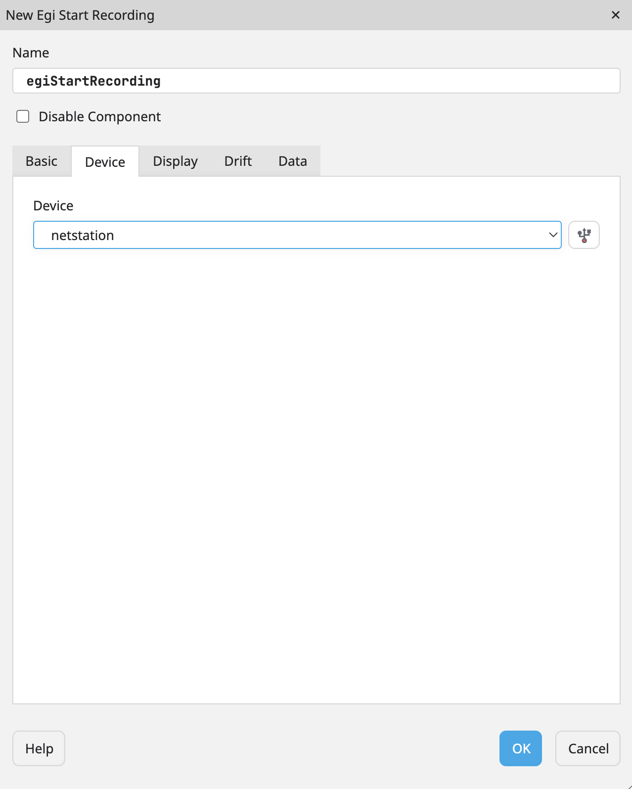
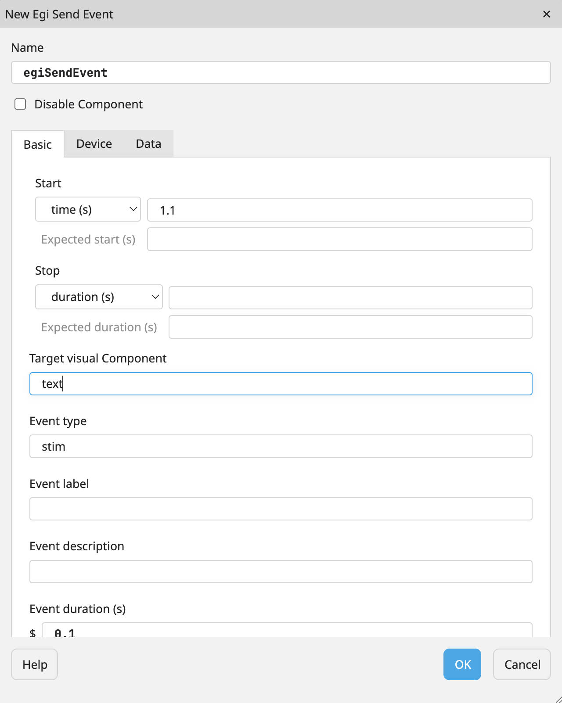
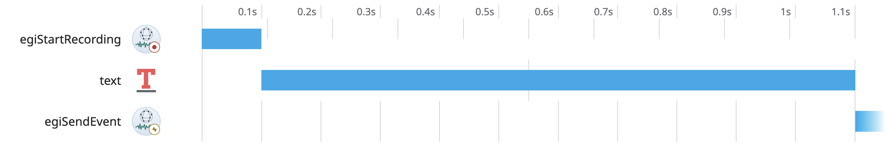

Getting started
===============

Requirements
------------

You need Python 3.10 or newer, PsychoPy 2026.1 or newer, and a
network-reachable NetStation host with ECI enabled. Ask the NetStation
administrator for three values:

* the IP address of the computer running NetStation;
* the ECI port, normally ``55513``; and
* the amplifier's NTP server IP address.

Install
-------

Install the package in the Python environment used by PsychoPy, then restart
PsychoPy so Studio discovers the new entry points:

.. code-block:: console

   python -m pip install psychopy-egi-pynetstation

Choose an interface
-------------------

The installation supports three interfaces to the same NetStation wrapper:

* **Builder or Studio Components backed by Device Manager** for experiments
  assembled in PsychoPy;
* a **direct Python import** for the smallest code-only setup; or
* PsychoPy's **Device Manager** when a code experiment already uses its shared
  device registry.

Builder is not required for either Python option. See :doc:`python-api` for the
two code-only forms and their common recording workflow.

Builder and Studio quick start
------------------------------

Both PsychoPy Studio and the classic desktop Builder in supported PsychoPy
2026.1+ releases provide Device Manager. Neither interface needs a Connect or
Disconnect Component. PsychoPy versions before 2026.1 are not supported by
this plugin.

Open the Components panel and expand **I/O > EEG**. EGI Start Recording, EGI
Send Event, and EGI Stop Recording should appear alongside PsychoPy's other EEG
Components. Configure the device, then add the Components to the Flow:

   The plugin adds EGI Start Recording, EGI Send Event, and EGI Stop Recording
   to the EEG section of the Components panel.

.. rst-class:: workflow

1. Open **Device Manager**, add **EGI NetStation**, choose the manual profile,
   enter the network settings, and name the device ``netstation``. The generated
   experiment connects during device setup.
2. **EGI Start Recording** where recording should begin; select ``netstation``.
3. **EGI Send Event** wherever a marker is needed. Use a four-character event
   type such as ``stim`` or ``resp`` and select the same device.
4. **EGI Stop Recording** near the end.

When adding the device, use a stable label such as ``netstation`` and select
the **EGI NetStation (manual configuration)** profile:

The Start Recording Component then selects that same label:

NetStation amplifiers cannot be auto-discovered. The listed manual profile is
an editable starting point, not evidence that an amplifier was found.

Device Manager profiles are per-user PsychoPy configuration stored in
``devices.json``; they are not embedded in the ``.psyexp`` file. The experiment
stores the selected label only. On another computer or user account, install
the plugin and recreate or import an EGI NetStation profile with the same label
before generating the script. The generated Python script contains the
resolved setup code.

These are momentary commands: each runs once when its Component starts. A
Component's **Stop** field does not control the command and should normally be
left blank. **Event duration (s)** on EGI Send Event is different—it is the
duration stored with the NetStation event.

Each EGI Component has independent Builder timing state even though all of them
share one Device Manager object, so multiple EGI commands may be scheduled in
one Routine. PsychoPy closes the registered device on normal or early experiment
exit. Its idempotent cleanup stops an active recording, flushes events, and
disconnects; keep EGI Stop Recording to define the precise recording endpoint.

One connection supports one recording epoch. Use separate experiment runs when
another recording epoch is required.

For a visual marker, enter the visual Component's exact name in **Target visual
Component**. In this example, the ``stim`` marker is attached to the first flip
that draws the Component named ``text``:

   Put EGI Send Event below its target visual Component in the Routine.

.. _coder-quick-start:

Coder quick start
-----------------

Builder is not required. In PsychoPy Coder, directly import the wrapper for the
smallest setup. The example below creates a window, connects, starts recording,
marks one visual flip, and cleans up safely:

.. code-block:: python

   from psychopy import visual
   from psychopy_egi_pynetstation import EGINetStation

   win = visual.Window()
   ns = EGINetStation(
       ip="10.10.10.42",
       ntpIP="10.10.10.51",
       port=55513,
   )

   try:
       ns.connect()
       ns.beginRecording()

       win.callOnFlip(
           ns.sendEvent,
           eventType="stim",  # exactly four characters
           label="face",
           duration=0.1,
       )
       win.flip()
   finally:
       ns.close()
       win.close()

Coder with Device Manager
~~~~~~~~~~~~~~~~~~~~~~~~~

When a Coder experiment already uses PsychoPy's shared device registry, create
the same wrapper through ``DeviceManager`` instead:

.. code-block:: python

   from psychopy.hardware import DeviceManager

   ns = DeviceManager.addDevice(
       deviceClass="psychopy_egi_pynetstation.hardware.netstation.EGINetStation",
       deviceName="netstation",
       ip="10.10.10.42",
       ntpIP="10.10.10.51",
       port=55513,
   )

Then use the same ``ns.connect()``, ``ns.beginRecording()``,
``win.callOnFlip(ns.sendEvent, ...)``, and ``ns.close()`` workflow shown above.
Retrieve the registered object later with
``DeviceManager.getDevice("netstation")``. See :doc:`python-api` for method
details and non-visual event usage.

Preflight checklist
-------------------

Before collecting data:

* confirm that ECI is enabled and the PsychoPy computer can reach the host and
  NTP addresses;
* send a four-character test event and verify its label and duration in
  NetStation;
* stop recording and disconnect cleanly so queued asynchronous events flush;
* inspect the PsychoPy log for asynchronous send failures, rejected ECI
  responses, and drift-health warnings;
* inspect ``ns.sessionSummary()`` in Coder experiments when deciding whether to
  accept a run; and
* validate the workflow using non-production data on the actual lab network.

Testing without an amplifier
----------------------------

Enable **Dummy mode — run without EEG hardware** in the EGI NetStation
Device Manager settings, or in the legacy NetStation Init component. Leave
your Start Recording, Send Event, and Stop Recording components in place.
The setting defaults to off; turn it off again for real data collection.

Python experiments can select the same mode with
``EGINetStation(dummyMode=True)``. Calls use an offline backend: no network
traffic or background sampling occurs, and drift-readiness waits return
immediately with ``skipped=True`` and ``reason='dummy_mode'``. This does not
mean that a real drift model is ready.

Events are validated and counted as ``simulated_events`` in
``sessionSummary()``; ``events_sent`` remains zero. No EEG, detailed marker
log, or ECI error log is written. Clock methods use local monotonic time from
the start of recording, so this mode tests experiment flow rather than
hardware synchronization. A startup warning identifies dummy sessions.
The normal Python dependencies are still required. A failed real connection
never automatically enables dummy mode.

Startup mode selection and connection recovery
==================================================

Both options below default to off and are available in Device Manager and the
legacy Connect component (startup selection is also available in legacy Init).

* **Choose EEG mode at startup** adds an **EEG mode (device name)** dropdown to
  the participant/session dialog, before the device is created. Select
  **Record EEG** or **Dummy — no EEG recorded**. The saved Dummy mode checkbox
  supplies the default, including when the participant dialog is skipped.
  The per-run choice never edits the saved device configuration.
* **Ask after connection failure** offers an Action dropdown with **Abort**,
  **Retry**, and **Continue without EEG**. Select an action and press OK.
  Abort is the default; Cancel or closing the dialog also aborts. Retry uses
  a fresh client after cleanup, and continuing switches to the dummy backend.

Recovery covers expected network and ECI response failures during connection
setup only. Invalid settings still raise. Amplifier NTP failures at recording
start and mid-run failures are not converted into dummy sessions. Recovery is
also disabled once the device has recorded during that run.

Builder saves requested and effective modes, connection status, fallback use,
and failure messages under ``netstation.<device name>.*`` in the experiment's
info dictionary. The original startup choice is retained; the effective mode
reflects a subsequent fallback.

Coder scripts can call ``ns.setRunInfo(expInfo, "netstation")`` to attach the
same metadata and pass ``onFailure=askConnectionFailure`` to ``ns.connect()``
after importing that callback from ``psychopy_egi_pynetstation.startup``.
Without a callback, connection errors raise without a dialog. Headless scripts
can provide their own callback taking ``(error, ip, port)`` and returning
``'retry'``, ``'dummy'``, or ``'abort'``.
